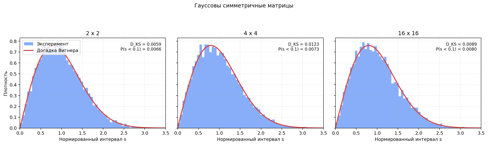
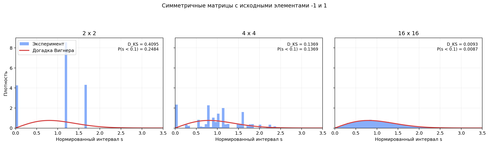

# Спектральные интервалы случайных симметричных матриц

## Методика

Для каждого размера `2 x 2`, `4 x 4` и `16 x 16` исследовано по 10 000
матриц. Сначала генерировалась матрица `X` с независимыми элементами, затем
строилась вещественная симметричная матрица

```text
A = X + X.T.
```

В первом случае элементы `X` имели нормальное распределение с нулевым средним
и единичным среднеквадратичным отклонением. Во втором случае каждый элемент
`X` с вероятностью `1/2` принимал значение `-1` или `1`.

Собственные числа каждой матрицы вычислялись в порядке возрастания. Для всех
матриц одного размера использовалась одна и та же центральная пара:

- `2 x 2`: `lambda_2 - lambda_1`;
- `4 x 4`: `lambda_3 - lambda_2`;
- `16 x 16`: `lambda_9 - lambda_8`.

Каждый набор интервалов делился на собственное среднее значение, поэтому
средний нормированный интервал равен единице. Для воспроизводимости расчёта
использовано начальное значение генератора `20261029`.

Для численного сравнения с догадкой Вигнера применено расстояние
Колмогорова-Смирнова `D_KS`. Чем оно меньше, тем ближе эмпирическое
распределение к функции

```text
p(s) = pi*s/2 * exp(-pi*s^2/4).
```

## Гауссов ансамбль



| Размер | Средний интервал до нормировки | D_KS | P(s < 0.1) | P(s = 0) |
| --- | ---: | ---: | ---: | ---: |
| 2 x 2 | 3.537995 | 0.0059 | 0.0066 | 0.0000 |
| 4 x 4 | 2.377978 | 0.0123 | 0.0073 | 0.0000 |
| 16 x 16 | 1.133100 | 0.0089 | 0.0080 | 0.0000 |

Для `2 x 2` теоретическое среднее ненормированного интервала равно
`2*sqrt(pi) = 3.544908`. Экспериментальное значение отличается от него менее
чем на `0.2%`.

Все три гистограммы близки к догадке Вигнера: максимальное значение `D_KS`
равно `0.0123`. Небольшие неровности столбцов объясняются конечным размером
выборки.

В окрестности нуля плотность стремится к нулю линейно:

```text
p(s) = pi*s/2 + O(s^3).
```

Поэтому почти совпадающие собственные числа встречаются редко. Это явление
называется отталкиванием уровней. По формуле Вигнера
`P(s < 0.1) = 0.0078`; полученные значения `0.0066`, `0.0073` и `0.0080`
согласуются с ним.

## Матрицы с исходными элементами -1 и 1



| Размер | Средний интервал до нормировки | D_KS | P(s < 0.1) | P(s = 0) |
| --- | ---: | ---: | ---: | ---: |
| 2 x 2 | 3.422933 | 0.4095 | 0.2484 | 0.2484 |
| 4 x 4 | 2.524250 | 0.1369 | 0.1369 | 0.1369 |
| 16 x 16 | 1.164830 | 0.0093 | 0.0087 | 0.0000 |

Для размеров `2 x 2` и `4 x 4` распределение заметно дискретно. У него есть
отдельные пики и ненулевая вероятность точного совпадения соседних собственных
чисел. Поэтому поведение около нуля сильно отличается от догадки Вигнера.

При размере `16 x 16` отдельные значения сливаются в почти непрерывное
распределение. Значение `D_KS = 0.0093`, а доля интервалов меньше `0.1` равна
`0.0087`. По этим показателям результат уже близок к гауссову ансамблю и к
кривой Вигнера.

## Аналитический результат для 2 x 2

Пусть элементы исходной матрицы независимы и равны `-1` или `1`:

```text
X = [[A, B],
     [C, D]].
```

После симметризации

```text
X + X.T = [[2*A, B + C],
           [B + C, 2*D]].
```

Расстояние между двумя собственными числами равно

```text
g = 2*sqrt((D - A)^2 + (B + C)^2).
```

Обе величины `D - A` и `B + C` равны нулю с вероятностью `1/2`, а по модулю
равны двум с вероятностью `1/2`. Они независимы, поэтому ненормированный
интервал имеет распределение

| g | Вероятность |
| ---: | ---: |
| 0 | 1/4 |
| 4 | 1/2 |
| 4*sqrt(2) | 1/4 |

Его среднее значение равно

```text
E[g] = 2 + sqrt(2).
```

После нормировки к среднему значению один получаем

| s | Вероятность |
| ---: | ---: |
| 0 | 1/4 |
| 4 - 2*sqrt(2) = 1.1715728753 | 1/2 |
| 4*sqrt(2) - 4 = 1.6568542495 | 1/4 |

Три значения точно соответствуют трём пикам на экспериментальной гистограмме.
Доля нулевых интервалов `0.2484` близка к аналитической вероятности `0.25`.

## Вывод

Для гауссовых симметричных матриц распределение центрального спектрального
интервала хорошо описывается догадкой Вигнера при всех рассмотренных размерах.
Плотность около нуля подавлена из-за отталкивания уровней.

Для дискретных матриц малых размеров точные совпадения собственных чисел имеют
заметную вероятность, поэтому распределение состоит из отдельных пиков. С
увеличением размера влияние дискретности ослабевает, и при `16 x 16`
распределение практически совпадает с результатом для гауссова ансамбля.

## Запуск

Из этой папки:

```bash
python3 -m pip install numpy matplotlib
python3 main.py
```

Программа печатает численные характеристики и заново создаёт оба рисунка.
