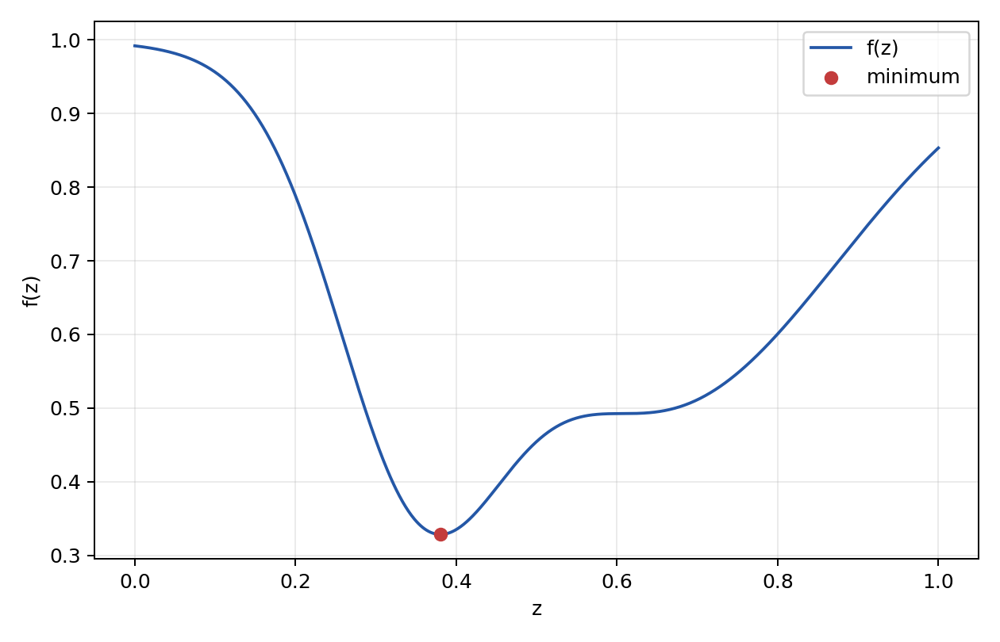
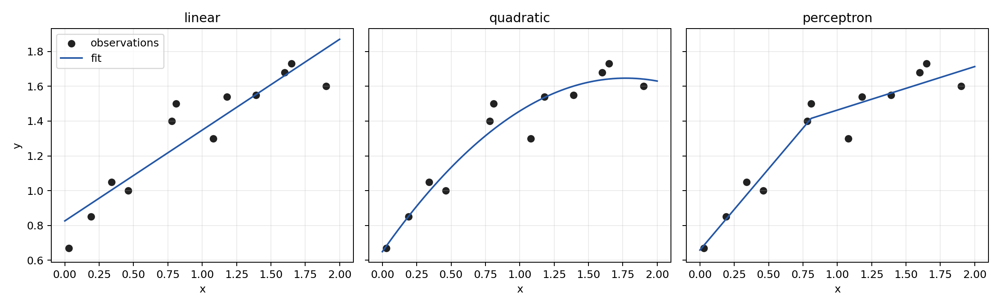
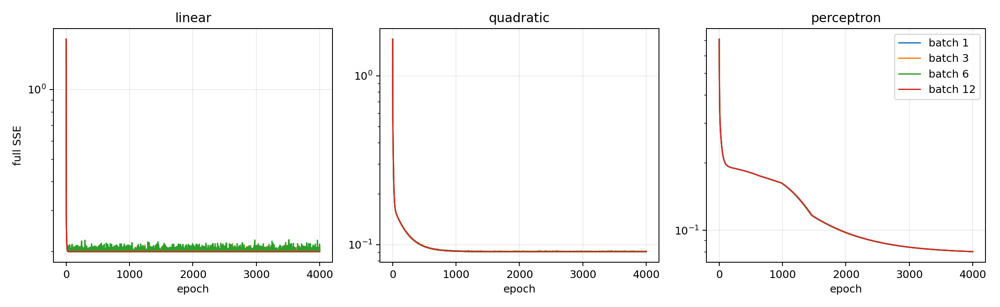
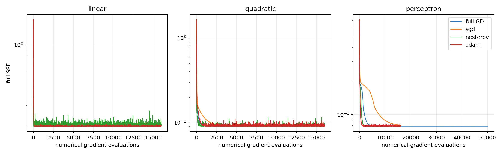

# Численные методы оптимизации

## Минимум функции одной переменной

Рассматривается функция

```text
f(z) = 1 - 0.5*exp(-10*(z - 0.65)^2)
         - 0.45*exp(-50*(z - 0.35)^2).
```

На промежутке `[0, 1]` функция имеет один минимум. За пределами этого промежутка обе экспоненты уменьшаются, а значение функции стремится к единице. Для поиска минимума реализован метод золотого сечения. Поиск прекращается, когда длина текущего интервала становится меньше `10^-12`.

Полученный результат:

```text
z_min = 0.380321529159
f(z_min) = 0.328603657469
число итераций = 59
```



## Полный градиентный спуск

Для всех моделей минимизируется полная сумма квадратов ошибок:

```text
SSE = sum((y_i - y_hat(x_i))^2).
```

Производные вычисляются центральной разностью. Для параметра `theta_j` используется шаг

```text
h_j = 10^-5*max(1, abs(theta_j)),

d(SSE)/d(theta_j) =
    (SSE(theta_j + h_j) - SSE(theta_j - h_j))/(2*h_j).
```

Для линейной, квадратичной моделей и перцептрона скорости обучения равны `0.025`, `0.006` и `0.002`. Критерий остановки - норма численного градиента меньше `10^-7`.

| Модель | SSE | Итераций | Критерий остановки достигнут |
| --- | ---: | ---: | :---: |
| Линейная | 0.1998663569 | 154 | да |
| Квадратичная | 0.0908820415 | 5991 | да |
| Перцептрон | 0.0787943670 | 50000 | нет |

Параметры линейной модели:

```text
w1 = 0.522226
b1 = 0.825950
```

Параметры квадратичной модели:

```text
w1 = -0.318147
w2 = 1.126791
b1 = 0.649114
```

Параметры перцептрона:

```text
w11 =  0.512791    b11 = 0.367705
w12 = -0.986644    b12 = 0.799179
w21 =  0.487837    w22 = -0.694177
b21 =  1.033661
```

Перцептрон получил наименьшую SSE, но не достиг строгого критерия остановки за 50000 итераций. Его результат является состоянием на предельной итерации, а не подтвержденной стационарной точкой.



## Стохастический градиентный спуск

Проверены размеры минибатча `1`, `3`, `6` и `12`. Перед каждой из 4000 эпох наблюдения перемешиваются генератором с seed `42`. Каждый минибатч использует сумму квадратов ошибок только по входящим в него наблюдениям. За одну эпоху каждый объект используется ровно один раз.

| Модель | Размер минибатча | Итоговая SSE |
| --- | ---: | ---: |
| Линейная | 1 | 0.2050881189 |
| Линейная | 3 | 0.2074086432 |
| Линейная | 6 | 0.2017929395 |
| Линейная | 12 | 0.1998663569 |
| Квадратичная | 1 | 0.0911376663 |
| Квадратичная | 3 | 0.0915454060 |
| Квадратичная | 6 | 0.0912530740 |
| Квадратичная | 12 | 0.0908820417 |
| Перцептрон | 1 | 0.0804176431 |
| Перцептрон | 3 | 0.0804296748 |
| Перцептрон | 6 | 0.0804461857 |
| Перцептрон | 12 | 0.0804834209 |

При размере минибатча `12` метод совпадает с полным градиентным спуском, но ограничен 4000 эпохами. Для линейной и квадратичной моделей увеличение минибатча уменьшает колебания и дает меньшую итоговую ошибку. Для перцептрона различия между четырьмя результатами невелики. Малые минибатчи выполняют больше обновлений за одну эпоху, поэтому после одинакового числа проходов по данным они немного опережают полный батч для этой модели.

При постоянной скорости обучения траектория небольшого минибатча продолжает колебаться около минимума. Поэтому итоговая SSE отдельного запуска зависит от последней перестановки наблюдений и не должна интерпретироваться как точное ранжирование размеров минибатча.



## Импульс Нестерова и Adam

Для сравнения использован размер минибатча `3`, одинаковые начальные параметры и одно разбиение на минибатчи. Коэффициент импульса Нестерова равен `0.9`. Для Adam используются `beta_1 = 0.9`, `beta_2 = 0.999` и скорости обучения `0.015`, `0.012`, `0.006` для трех моделей соответственно.

| Модель | Полный GD | SGD | Нестеров | Adam |
| --- | ---: | ---: | ---: | ---: |
| Линейная | 0.1998663569 | 0.2074086432 | 0.2053407848 | 0.2006769412 |
| Квадратичная | 0.0908820415 | 0.0915454060 | 0.0911426461 | 0.0908856258 |
| Перцептрон | 0.0787943670 | 0.0804296748 | 0.0791445293 | 0.0791328365 |

Импульс Нестерова и Adam во всех трех случаях дали меньшую итоговую ошибку, чем обычный SGD с тем же размером минибатча. Adam оказался немного лучше импульса Нестерова. Полный градиентный спуск достиг наименьшей SSE, но использовал другое число обновлений: 154, 5991 и 50000 для трех моделей. Поэтому итоговые значения показывают качество полученных решений, а график по числу вычислений градиента показывает различия скорости сходимости.



## Запуск

```bash
python3 -m pip install numpy matplotlib
python3 main.py
```

Программа заново выполняет все расчеты и сохраняет четыре графика в текущей папке.
